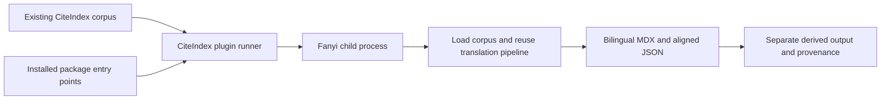

# CiteIndex plugins: detachable Fanyi translation

Status: implemented and verified locally; see the implementation record below.
Date: 2026-10-14.

## Requested outcome and confirmed decisions

Add an optional plugin system to CiteIndex, with Fanyi as the first plugin.
The user confirmed:

- Translate an **already ingested document on demand**.
- Install Fanyi into the **same Python environment** as CiteIndex; Fanyi registers itself as a plugin.
- Produce **bilingual MDX and aligned JSON**.
- Installing or removing the plugin adds or removes the translation feature. Normal CiteIndex installation must remain sufficient for ingestion.

Fanyi can remain a private/local project. Plugin discovery requires installed package metadata, not a public repository or public package release. These are architecture and distribution choices; this plan does not audit dependency licenses.

## Evidence from the current repositories

Paths below describe the current checkout, not proposed APIs. CiteIndex was inspected at commit `7bc47f3`; an existing unrelated `uv.lock` modification is outside this task.

| Finding | Source |
| --- | --- |
| CiteIndex exposes an ingestion CLI and uses Python >=3.12. | [pyproject.toml](../../pyproject.toml#L21), [CLI](../../citeindex/cli.py#L65) |
| Its public `ingest()` API delegates to the orchestrator. | [citeindex/__init__.py](../../citeindex/__init__.py#L30) |
| Ingestion finalizes CSL, persists corpus artifacts, then writes library Markdown and `ingestion_output.json`. | [master.py](../../citeindex/ingestion/master.py#L33) |
| Re-ingestion replaces selected corpus artifacts, so derived translations should live outside that artifact set. | [storage.py](../../citeindex/ingestion/storage.py#L103) |
| CiteIndex already has an external-package integration with an optional subprocess path for Wenbi. | [media.py](../../citeindex/ingestion/pipelines/media.py#L214) |
| Fanyi already depends on CiteIndex, with a local editable source configured for development. | [Fanyi pyproject.toml](../../../fanyi/pyproject.toml) |
| Fanyi's CLI accepts an existing corpus, but still requires an existing input file and uses its name for outputs. It is not a corpus-only plugin interface yet. | [Fanyi CLI](../../../fanyi/src/fanyi/cli.py#L123), [corpus branch](../../../fanyi/src/fanyi/cli.py#L179) |
| `load_from_corpus()` reads CSL and library Markdown or structured document blocks; usable text is required. | [citeindex_adapter.py](../../../fanyi/src/fanyi/core/citeindex_adapter.py#L456) |
| Translation orchestration is embedded in the CLI: filtering, chunking, glossary work, routing, alignment, rendering. | [cli.py](../../../fanyi/src/fanyi/cli.py#L229), [translation](../../../fanyi/src/fanyi/cli.py#L300), [rendering](../../../fanyi/src/fanyi/cli.py#L449) |
| Fanyi has reusable translation routing, alignment, MDX rendering, and JSON rendering. | [router.py](../../../fanyi/src/fanyi/translator/router.py#L27), [aligner.py](../../../fanyi/src/fanyi/core/aligner.py#L15), [renderer.py](../../../fanyi/src/fanyi/core/renderer.py#L242) |
| Importing Fanyi's DSPy engine configures a global adapter. | [dspy_engine.py](../../../fanyi/src/fanyi/translator/dspy_engine.py#L39) |
| Fanyi's web API currently has a separate extraction/job path. | [jobs.py](../../../fanyi/src/fanyi/api/jobs.py#L126) |

## Recommended design

Use Python package entry points for discovery. Start with one extension point: explicitly requested processing of a completed corpus. Keep extraction, citation verification, and metadata finalization in their existing pipeline.

Fanyi declares this registration in its own `pyproject.toml`:

```toml
[project.entry-points."citeindex.plugins.v1"]
fanyi = "fanyi.citeindex_plugin:run"
```

The versioned group defines the first plugin contract. CiteIndex discovers names through `importlib.metadata`; it does not import every plugin at startup. There is no Fanyi dependency in CiteIndex's base dependencies, and no second adapter distribution is needed.

Dependency direction stays `Fanyi -> CiteIndex`. CiteIndex invokes an installed entry point through its generic runner rather than adding a static import of Fanyi. Fanyi must raise its minimum CiteIndex version to the release introducing this contract.

Run the selected plugin in a child process using `sys.executable`: the same installed environment, a separate Python process. This contains Fanyi's DSPy configuration changes. It does **not** resolve incompatible package requirements or provide a security sandbox. Check dependency resolution before shipping.



### Installation and commands

Implemented installation and command workflow:

```sh
# Development: install both projects into the same active environment.
python -m pip install -e /home/ajiap/project/citeindex
python -m pip install -e /home/ajiap/project/fanyi

citeindex-plugin list
citeindex-plugin run fanyi corpus/Author_Title_hash \
  --options fanyi-options.json --output translations/Author_Title_hash/zh

# Detach translation; do not remove CiteIndex or existing translations.
python -m pip uninstall fanyi
```

Use a companion `citeindex-plugin` command supplied by CiteIndex. This avoids changing the existing `citeindex <input>` parser or reserving a filename as a new subcommand. Its Python equivalent is `citeindex.plugins.run_plugin(...)`.

Example plugin options:

```json
{
  "target_lang": "zh",
  "engine": "dspy",
  "format": "mdx"
}
```

`zh` is an example, not a confirmed required language. Require the target language explicitly; preserve Fanyi's supported engine/model/glossary/cache options. Keep translation credentials in Fanyi's existing environment configuration, outside result manifests. CiteIndex validates generic runner arguments; Fanyi validates its own options and rejects unknown keys.

A public `citeindex[fanyi]` installation extra is deferred: it would need a resolvable Fanyi distribution for the intended users. Local editable installation or a private wheel already satisfies the confirmed workflow.

### Small versioned contract

The plugin callable accepts one JSON-compatible request and returns one JSON-compatible result. Use dictionaries and validation; no plugin base-class hierarchy or hook framework.

Request fields: `protocol_version`, absolute `document_path`, host-owned staging `output_dir`, and `options`. The runner validates that the corpus is a completed ingestion with readable metadata before starting work. The adapter validates usable text and supported source structure before making translation requests. It calls `load_from_corpus()` directly, never `extract_via_citeindex()` or `ingest()`.

Result fields: `protocol_version`, `status` (`ok`, `partial`, or `failed`), relative `artifacts` paths, actual engine/model information, QA summary, and structured errors/warnings. A requested chunk that failed or an incomplete translation must not become an unqualified `ok`. Carry existing Fanyi fallback/error signals through this boundary; investigate whether its current string results need additional failure metadata during implementation.

The host and worker exchange JSON using temporary request/result files. Logs go to stderr; third-party stdout messages must not corrupt the result transport. Invoke a fixed worker module with an argument list, never a shell command assembled from options. Enforce a positive configurable timeout and terminate/reap the worker on timeout or cancellation. Reject malformed results, incompatible versions, missing artifacts, and artifact paths escaping the staging directory, including symlinks.

The host writes a provenance manifest with the source corpus identity, hashes of actual source artifacts consumed, plugin/distribution version, sanitized translation settings, output hashes, status, and QA summary. Keep any provider credentials out of it. Use installed distribution metadata for package versions.

### Source and output rules

- Read the original corpus and library Markdown. Do not edit `csl.json`, `document.json`, source evidence, Merkle data, ingestion results, or library Markdown.
- Preserve source text and original locators in aligned output. Translations are derived text and must not be presented as original-source quotation evidence.
- Render MDX using Fanyi's existing renderer and emit its aligned JSON. Preserve headings, footnotes, bibliography handling, and relative image references; copy referenced images into derived output when necessary, without fetching remote assets implicitly.
- Write into a staging directory adjacent to the requested destination. Publish successful output only after validating artifacts. Refuse an existing nonempty destination in v1, so a failed rerun cannot destroy earlier translations.
- Keep partial results explicitly labeled and separate from successful output; return a nonzero CLI status for partial/failed runs. Never alter the successful ingestion status.
- Record source-file digests before and after translation; fail publication if consumed inputs changed during the run. This detects concurrent re-ingestion, not a transactional corpus snapshot.
- Installed plugins are trusted local code. Process separation prevents global configuration leakage; it does not enforce read-only filesystem access. Verify the official Fanyi adapter's non-mutation behavior in tests.
- The plugin never launches an independent citation harness audit. Existing explicit harness workflows remain the route for that review.

## Implementation steps and affected files

### 1. Add the minimal plugin host in CiteIndex

Create `citeindex/plugins.py` with discovery, request/result validation, `run_plugin()`, worker invocation, and the small CLI. Add `citeindex-plugin = "citeindex.plugins:main"` to [pyproject.toml](../../pyproject.toml#L24). Discovery lists installed entry-point names/distribution versions without loading plugin code; duplicate names fail clearly rather than selecting arbitrarily.

Keep the public API under `citeindex.plugins`; no top-level re-export or ingestion config change is needed. Add a focused `tests/test_plugins.py` using a fake plugin/worker for success and failure contracts. No changes are planned to `master.py`, `storage.py`, or existing ingestion callers.

### 2. Extract Fanyi's shared translation workflow

Move the reusable post-extraction work from [Fanyi cli.py](../../../fanyi/src/fanyi/cli.py#L229) into one callable in a proposed `src/fanyi/core/translation.py`. It accepts normalized extraction results and translation/output options. Keep terminal presentation in the Click command.

Update the existing CLI caller to use this shared workflow. Preserve filtering, main-text/footnote/bibliography chunking, glossary preprocessing/postprocessing, cache behavior, fallback, alignment/QA, output formats, and image handling. Add a focused regression test with fake translation responses comparing CLI and plugin paths. Inspect any existing CLI tests/fixtures before moving the code and update affected imports/callers.

The FastAPI job path is outside this release; do not broaden this extraction into a web/API rewrite.

### 3. Register Fanyi and adapt existing corpora

Add `src/fanyi/citeindex_plugin.py` with the `run(request)` entry point. Load the exact supplied corpus path, call the shared workflow, and return validated artifacts and quality/failure metadata. Do not search by PDF stem or require the original PDF to still exist.

Update Fanyi's packaging with the entry point and the minimum supporting CiteIndex version. Update locks only through the projects' existing dependency tooling and only for necessary dependency changes. The current unrelated CiteIndex `uv.lock` diff must be preserved.

Initially validate digital/scanned PDF corpora, matching Fanyi's existing primary workflow. Reject unsupported/no-text corpus structures clearly. URL/media/Office-derived translation can be added to the advertised support matrix only after representative corpus tests pass; the generic host does not assume all plugins support all source types.

### 4. Prove installation, detachment, and artifact integrity

Add one small corpus fixture covering text, heading, footnote, and image references. Exercise the host-to-real-Fanyi-adapter path with a deterministic fake translator. Verify MDX and aligned JSON against the existing renderer's contract, including source locators and explicit partial failures.

In a temporary environment, validate dependency resolution and install both packages, discover/run the plugin, uninstall Fanyi, and confirm CiteIndex still starts and reports the plugin as unavailable. Confirm the built wheel includes the entry-point registration and new module. Add installation/use/removal instructions to both READMEs. A public/private package release is a separate distribution action.

## Acceptance criteria and verification

1. CiteIndex alone installs and ingests as before; listing plugins succeeds with an empty list. No Fanyi import occurs during normal ingestion or plugin listing.
2. Installing Fanyi in the same environment exposes exactly one `fanyi` entry point. Uninstalling it removes discovery without deleting corpus or derived files.
3. An existing corpus can produce bilingual MDX and aligned JSON with the original PDF removed; ingestion/extraction functions are not called.
4. Identical fixture inputs reach the same shared Fanyi translation workflow from CLI and plugin, preserving glossary/cache/fallback and alignment behavior.
5. Checksums for corpus evidence and library Markdown are identical before and after both successful and failed plugin runs. Derived output records the inputs it used.
6. A fake plugin that mutates child-process DSPy state cannot change the parent process's configuration. Missing/incompatible/broken plugins produce actionable errors.
7. Timeout, cancellation, malformed JSON, failed chunks, missing artifacts, path traversal/symlink escapes, and existing output destinations are covered by focused tests; no previous successful result is overwritten.
8. The representative PDF fixture produces usable MDX, aligned JSON, preserved footnote/locator data, and working local image references. Unsupported corpus structures fail before provider calls.
9. Existing ingestion CLI contract tests and Fanyi's affected CLI/renderer tests pass. The shared-environment installation test proves dependency compatibility for the chosen versions.
10. Documentation distinguishes translated text from source evidence and explains local/private installation, explicit execution, and removal.

Implementation validation should run the new focused tests first, then the existing affected tests and clean-environment packaging smoke check. A single small live translation can verify provider wiring after implementation; deterministic tests cannot establish translation quality. No paid/provider call is needed to validate this plan.

## Risks and remaining choices

| Risk or choice | Treatment |
| --- | --- |
| Shared dependency conflicts | Resolve/install both packages in a temporary environment before promising compatibility. If requirements conflict, report the concrete constraint and revisit the isolated-environment connector; do not silently relax version bounds. |
| CLI extraction changes existing Fanyi behavior | Move orchestration once, preserve error handling, and compare CLI/plugin fixture results. |
| Old corpora lack usable text or use unexpected layouts | Validate through the existing adapter and return a specific error; never silently re-ingest. |
| Fanyi catches translation failures internally | Preserve/report chunk-level failure signals and mark incomplete output `partial`; do not infer success from file existence. |
| Re-ingestion changes source while translating | Record and recheck consumed-file digests before publishing output. |
| Target language and model are not yet chosen | Make them runtime translation choices; require target language and reuse existing Fanyi model configuration. |
| Command naming | `citeindex-plugin` is proposed to avoid altering the ingestion parser. A unified `citeindex plugins` UX can be chosen before implementation if desired. |
| First supported source types | Proposed release gate is digital/scanned PDF corpora. Broader source types require their own fixtures. |

## Stop condition and deferred work

The user subsequently requested implementation. All four implementation steps are complete; the verification record below defines the completed scope.

Defer automatic post-ingestion translation, extraction/OCR replacement hooks, plugin marketplaces/installers, remote discovery, hot reload, plugin dependency graphs, web UI/API integration, and public publication. Use pip for install/removal and the standard library for discovery/process orchestration; no new plugin framework is needed.

Planning validation, before implementation: read-only source/packaging inspection, graph discovery, and confirmation of user preferences.

## Implementation record

Completed all four steps on 2026-10-14:

1. Added [citeindex/plugins.py](../../citeindex/plugins.py), companion CLI registration, version `0.14.0`, and [host regression tests](../../tests/test_plugins.py). Normal ingestion configuration and persistence code remain untouched.
2. Extracted Fanyi's [shared translation workflow](../../../fanyi/src/fanyi/core/translation.py); its existing CLI uses the same callable. Early page-option validation, glossary/cache behavior, and primary/fallback routing are preserved.
3. Registered [Fanyi's corpus plugin](../../../fanyi/src/fanyi/citeindex_plugin.py). Added per-chunk engine/model/cache provenance and retained original records, page metadata, caption/footnote/bibliography block IDs, and image references in aligned JSON.
4. Added [Fanyi regression tests](../../../fanyi/tests/test_citeindex_plugin.py), updated both READMEs, built/installed both wheels in a temporary test environment, and verified removal. Independent architecture review approved the implementation after correcting normalized manifest-name collisions and mixed-engine provenance. A bounded cleanup pass removed extraction-related dead imports/code and was followed by regression checks.

Final verification:

- CiteIndex: **69 passed** across `test_plugins.py`, `test_cli_citation_verification.py`, and `test_multimodal_contracts.py`. This includes **38 plugin-host tests**.
- Fanyi: **124 passed** across the 15 affected plugin, adapter, CLI, chunker, router/fallback, cache, alignment, renderer, footnote, figure, and GEDSH test modules, run against the final files in the original repository.
- Both wheel builds passed. Installed-wheel integration used the actual Fanyi entry point and a deterministic provider stub: success and partial CLI exit codes, MDX/JSON/images, provenance hashes, and unchanged corpus all passed. No production test bypass was added.
- Uninstalling the Fanyi wheel left discovery empty and the ingestion CLI usable; requesting the detached plugin returned a clear unavailable error. Installation/removal occurred only in the temporary test environment; existing development environments were not reinstalled.
- A clean dependency-resolution dry run resolved both local projects together (**242 packages**). To avoid downloading the full OCR/GPU stack, wheel runtime smoke tests reused installed third-party packages. This is not a fresh installation of every resolved dependency.
- Both lockfiles were regenerated in isolated copies through `uv lock`; the only applied changes were the local CiteIndex version `0.13.4 -> 0.14.0`. Existing unrelated lockfile edits and Fanyi source edits were preserved. Fanyi changes were applied only after checking original file hashes, with backups under `/tmp/fanyi-before-plugin-20261014`.
- CiteIndex's new host/tests pass Ruff with the JSON-boundary exception-type style rule `TRY004` excluded; Fanyi's new modules/tests pass focused Ruff checks and formatting. `git diff --check` passed in CiteIndex. Whole-repository static/type checking was not performed.

Runtime limits:

- Actual translation quality and live provider credentials were not tested. Deterministic checks exercise the full orchestration without provider charges.
- Retained tables, skipped garbled chunks, empty/unchanged translations, and provider failures are explicitly incomplete and yield partial output. Existing table rendering is retained; this release does not add table-cell translation to the shared workflow.
- Legacy cached translations lack model identity; their actual model is `null` rather than guessed. The requested settings are recorded separately.
- Fanyi's pre-existing environment currently reports four dependency conflicts: installed OpenAI `3.29.0` against MinerU's `<3` requirement, Hugging Face Hub `2.2.0` against Gradio and gradio-client's `<2` bounds, and Pydantic `2.14.1` against Gradio's `<=2.12.3` bound. They were not repaired as part of plugin implementation; clean resolution succeeded, but these existing installations may need resynchronization before live use.

To enable the newly registered commands in an existing environment, reinstall both local packages there using the installation commands above. This work did not publish packages, commit changes, or run a live ingestion.

### Follow-up dependency cleanup

Removed unused `pdf2zh` and mandatory `mineru` from Fanyi's base requirements. Gradio, gradio-client, and gradio-pdf disappeared from the regenerated lockfile. Fanyi's existing optional `mineru` extra is retained because standalone OCR/table extraction still calls MinerU; corpus translation does not. The default exported dependency closure contains 124 packages and excludes pdf2zh, MinerU, and Gradio. In a temporary runtime without those packages, CLI/plugin imports and 47 translation/plugin/CLI/router tests passed. The updated wheel metadata was also checked. The existing Fanyi `.venv` was not synchronized or pruned by this metadata cleanup, so previously installed packages and their conflicts may remain there until synchronization.
